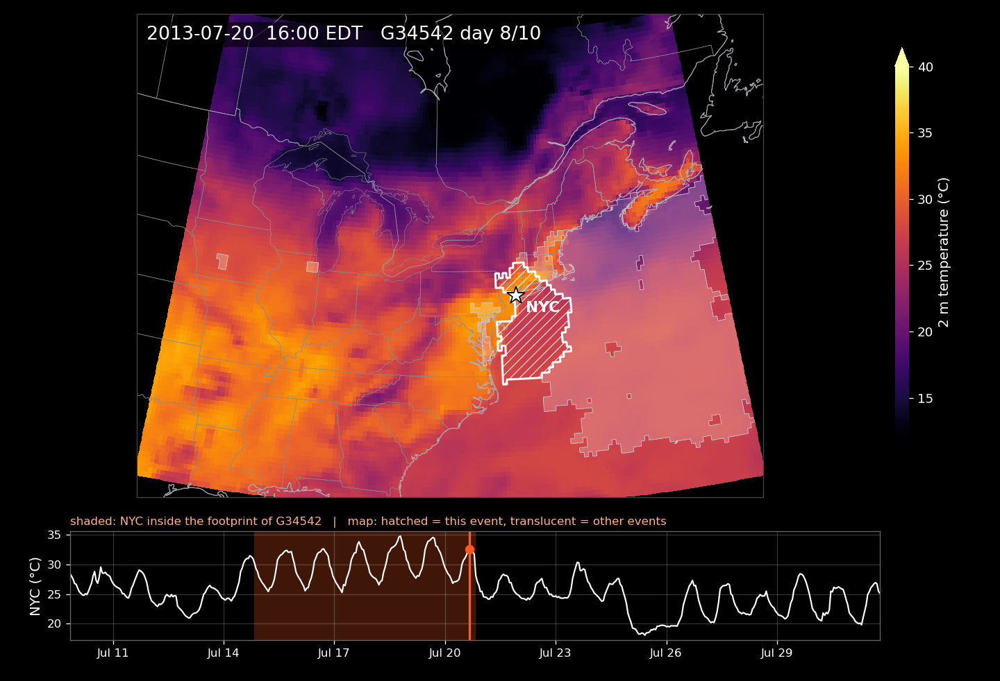

# TEMPO

Tools for working with the *North American heatwave objects on the 0.25° ERA5 grid, 1981–2026* catalogue
(Bian 2026, [doi:10.5281/zenodo.23966834](https://doi.org/10.5281/zenodo.23966834)).

The catalogue records heatwaves as objects: contiguous areas where the daily maximum 2 m temperature exceeds the local 1981–2010 90th
percentile for at least 3 days, followed from day to day as events lasting at least 5 days. The dataset itself is on Zenodo; this
repository holds code that reads it.

## Animating an event

`scripts/anim_event.py` animates one event over hourly ERA5 2 m temperature.

https://github.com/cbian-prog/TEMPO/raw/main/examples/anim_nyc_2013.mp4



The map shows hourly 2 m temperature, the event's footprint on each UTC day (white outline, hatched inside) and the footprints of the other
catalogued events on that day (translucent white). The lower panel shows the hourly temperature at a chosen point. The days on which the
point lies inside the event's footprint are shaded, and a cursor follows the map.

### Data

- **The catalogue**: download the dataset from Zenodo and unpack it into a folder. The script reads `heatwave_events.csv` and
  `heatwave_event_labels.nc`.
- **ERA5 hourly 2 m temperature**: either
  - `--t2m arco` reads it anonymously from the public [ARCO-ERA5](https://github.com/google-research/arco-era5) store on Google Cloud
    (no account needed; about 25 s per day of data for a box the size of the example), or
  - `--t2m <file.nc>` reads a local netCDF with variable `t2m` in K and dimensions `time` (or `valid_time`) × `latitude` × `longitude`,
    for example a download from the Copernicus Climate Data Store (*ERA5 hourly data on single levels*, variable 2m temperature).

### Usage

```bash
pip install -r requirements.txt

# July 2013, New York: the event is picked from the catalogue label at New York on 18 July
python scripts/anim_event.py --data path/to/na025_heatwave_objects_v1 \
    --point -74.01 40.71 --date 2013-07-18 --name NYC \
    --t2m arco --start 2013-07-10 --end 2013-07-31 --box -97 -60 30 54 \
    --out anim_nyc_2013.mp4
```

This writes `anim_nyc_2013.mp4`, a poster frame (`anim_nyc_2013_poster.png`, 20 UTC on the event's peak day) and a strip of six frames
(`anim_nyc_2013_frames.png`), as in [`examples/`](examples). The example picks event G34542 (13–22 July 2013), with New York inside its
footprint from 15 to 20 July.

| Option | Meaning |
|---|---|
| `--event G34542` | Animate this event instead of picking it with `--point` and `--date` |
| `--point LON LAT`, `--name` | Marked location and its label (required; it also gives the time series) |
| `--start`, `--end` | First and last UTC day shown (default: 3 days before the onset to 9 days after the end) |
| `--box LON0 LON1 LAT0 LAT1` | Map extent (default: the extent of the local file, or ±12° of longitude and ±9° of latitude around the event's peak) |
| `--utc-offset`, `--tz` | Clock in local time (default −4, EDT) |
| `--step`, `--fps` | Hours per frame (default 2) and frames per second (default 12) |
| `--vmin`, `--vmax` | Colour range in °C (default 12 to 40) |
| `--no-others` | Do not draw the other events of the day |

### Notes

- Footprints are daily (UTC days), so the outline changes at 00 UTC (20:00 EDT); the shading changes every frame.
- Longitudes run from −180 to 180, as in the dataset.
- Requirements: Python 3.10 or later, numpy, pandas, xarray, netCDF4, matplotlib, cartopy, imageio-ffmpeg (or `ffmpeg` on the PATH);
  `zarr` and `gcsfs` for `--t2m arco`.

## Citation

If you use the catalogue, please cite the dataset and ERA5:

- Bian, C. (2026). *North American heatwave objects on the 0.25° ERA5 grid, 1981–2026* (Version 1.0) [Data set]. Zenodo. https://doi.org/10.5281/zenodo.23966834
- Hersbach, H. et al. (2020). The ERA5 global reanalysis. *Quarterly Journal of the Royal Meteorological Society*, 146, 1999–2049. https://doi.org/10.1002/qj.3803

Citation metadata for this code is in [`CITATION.cff`](CITATION.cff).

Contains modified Copernicus Climate Change Service information. Neither the European Commission nor ECMWF is responsible for any use
that may be made of the Copernicus information or data it contains.

## Licence

The code is released under the Apache License 2.0 ([`LICENSE`](LICENSE)). The catalogue is released separately under CC BY 4.0.
